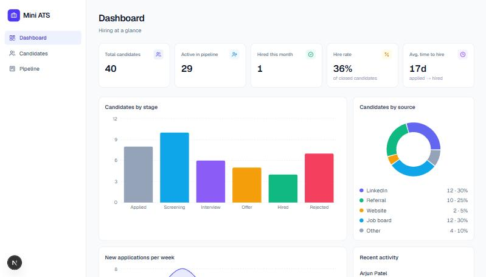
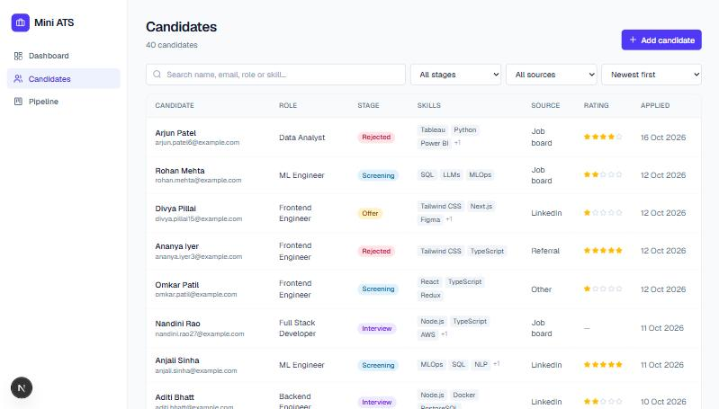
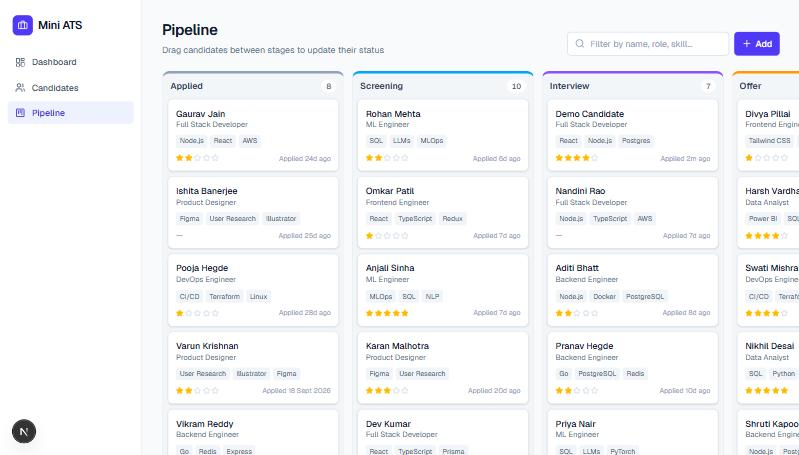

# Mini ATS

A lightweight Applicant Tracking System for managing candidates through a hiring pipeline, with search, filtering, and a live metrics dashboard.

**Live demo:** https://mini-ats-eight-wheat.vercel.app · **Demo video:** _add your Loom link here_



## Features

- **Candidate management:** add, edit, and delete candidates with name, email, phone, role, stage, source, skills, a 1–5 rating, and notes. Validated on both the client and the server, with errors shown next to each field. Duplicate emails are rejected.
- **Hiring pipeline:** a Kanban board with six stages (Applied → Screening → Interview → Offer → Hired / Rejected). Drag a card to move a candidate. The card moves immediately and is put back if the save fails. Moving someone to *Hired* or *Rejected* asks for confirmation.
- **Stage history:** every stage change is recorded, and the edit view shows the candidate's timeline.
- **Search and filters:** case-insensitive search across name, email, role, and skills (partial matches, e.g. `pyth` finds "Python"). Filter by stage and source, and sort by date, name, or rating. Filters are kept in the URL so a filtered view can be shared or bookmarked.
- **Dashboard:**
  - KPI cards: total candidates, active in pipeline, hired this month, hire rate, and average time to hire.
  - Charts: candidates by stage, candidates by source, and new applications per week.
  - A recent-activity feed.
- **Responsive** down to phone width.

| Candidates | Pipeline |
| --- | --- |
|  |  |

## Tech stack

| Layer | Choice | Why |
| --- | --- | --- |
| Framework | **Next.js 15** (App Router) + TypeScript | UI and REST API in one codebase, deployed together |
| Database | **PostgreSQL** (Neon) | Relational data, native enums and arrays |
| ORM | **Prisma** | Type-safe queries and versioned migrations |
| Validation | **Zod** | One schema validates API input and produces per-field errors |
| UI | Tailwind CSS, Recharts, dnd-kit, lucide-react, sonner | Small, focused libraries |
| Hosting | **Vercel** | Zero-config Next.js deploys |

## Architecture

```
src/
├── app/
│   ├── page.tsx                   Dashboard (server component, queries the DB directly)
│   ├── candidates/                Candidate list, search, filters
│   ├── pipeline/                  Kanban board
│   └── api/
│       ├── candidates/            GET (search/filter/sort), POST
│       ├── candidates/[id]/       GET (with history), PATCH, DELETE
│       ├── candidates/[id]/stage  PATCH (move stage + record history)
│       ├── metrics/               GET dashboard metrics
│       └── health/                GET DB connectivity check
├── components/                    Candidate form modal, charts, UI primitives
└── lib/
    ├── candidates.ts              Search query builder
    ├── metrics.ts                 Dashboard aggregation
    ├── validation.ts              Zod schemas
    └── constants.ts               Stages, sources, labels, colours
prisma/
├── schema.prisma
├── migrations/
└── seed.ts                        40 sample candidates with consistent stage histories
```

### Data model

```
Candidate                           StageHistory
─────────                           ────────────
id          cuid  PK                id           cuid  PK
name        text                    candidateId  → Candidate (cascade delete)
email       text  UNIQUE            fromStage    Stage?   (null = created)
phone       text?                   toStage      Stage
role        text                    changedAt    timestamp
stage       Stage  (indexed)
source      Source
skills      text[]
rating      int?   (1–5)
notes       text?
createdAt / updatedAt
```

Every stage change happens inside a transaction, which updates `Candidate.stage` and adds a `StageHistory` row. This is what makes "time to hire", "hired this month", and the activity feed accurate rather than estimated.

### API

| Method | Endpoint | Description |
| --- | --- | --- |
| `GET` | `/api/candidates?q=&stage=&source=&sort=` | List with search/filter/sort (`sort`: `newest`, `oldest`, `name`, `rating`) |
| `POST` | `/api/candidates` | Create (`409` on duplicate email, `400` with per-field errors on invalid input) |
| `GET` | `/api/candidates/:id` | Candidate plus stage history |
| `PATCH` | `/api/candidates/:id` | Partial update; records history if the stage changes |
| `DELETE` | `/api/candidates/:id` | Delete (history cascades) |
| `PATCH` | `/api/candidates/:id/stage` | `{ "stage": "INTERVIEW" }`; used by the Kanban board |
| `GET` | `/api/metrics` | Dashboard aggregates |
| `GET` | `/api/health` | `{ status, db }` |

## Running locally

Requires Node 20+ and a PostgreSQL database (a free [Neon](https://neon.tech) project works).

```bash
npm install
cp .env.example .env        # fill in DATABASE_URL and DATABASE_URL_UNPOOLED
npx prisma migrate deploy   # create tables
npm run db:seed             # optional: load 40 sample candidates
npm run dev                 # http://localhost:3000
```

| Variable | Description |
| --- | --- |
| `DATABASE_URL` | Pooled connection string, used by the app at runtime |
| `DATABASE_URL_UNPOOLED` | Direct (non-pooled) connection string, used by Prisma migrations |

## Deploying to Vercel

1. Import the GitHub repo in Vercel.
2. Add a Neon database from the Vercel Marketplace (Storage → Neon). It injects `DATABASE_URL` and `DATABASE_URL_UNPOOLED` automatically.
3. Deploy. The build runs `prisma generate && next build`. Functions run in `sin1` (Singapore), next to the database (see `vercel.json`).
4. Run the migration and seed once from your machine, with `.env` pointing at Neon: `npx prisma migrate deploy && npm run db:seed`.

## Trade-offs and next steps

Built in a single ~3-hour session, so scope was cut deliberately:

- **No authentication.** It's single-tenant, as if one recruiting team uses it. Next step: Auth.js with recruiter accounts and per-organisation data.
- **Role is free text,** not a separate `Job` table. A `Job` model with open/closed status and per-job pipelines would come next.
- **No pagination.** The list returns all matches, which is fine for hundreds of rows. Cursor pagination would be added beyond that.
- **No resume upload.** Next step: S3/R2 file uploads plus resume parsing.
- **Not built:** CSV import/export, email notifications on stage changes, and interview scheduling.
